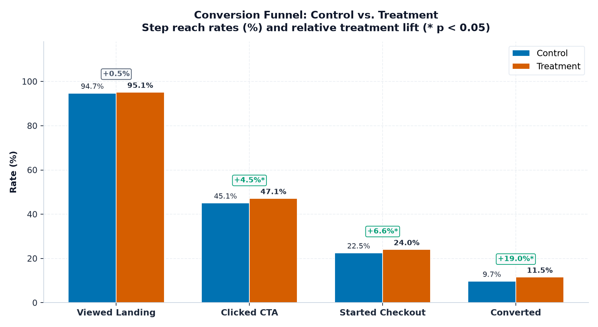
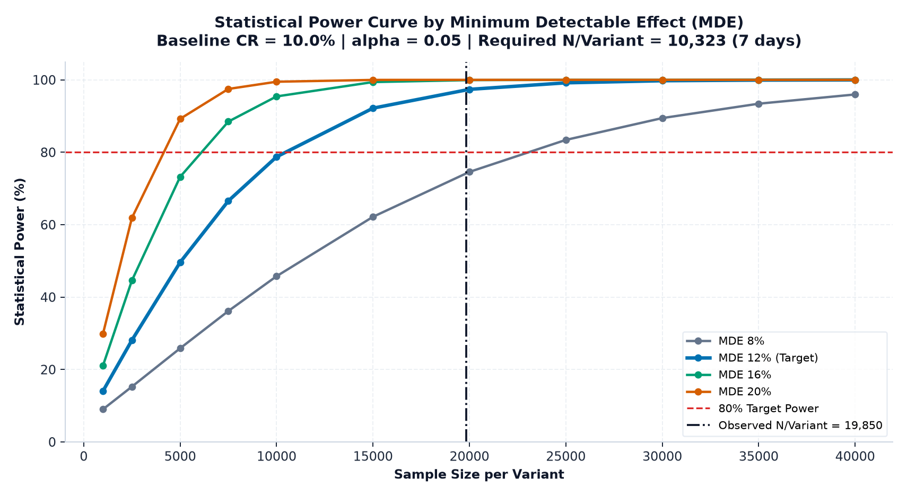

# Checkout Redesign A/B Experimentation Engine

**Dual Frequentist and Bayesian A/B testing pipeline for conversion rate, revenue per user, funnel drop-off, and subgroup lift—with automated Sample Ratio Mismatch (SRM) gating, Pydantic v2 data contracts, and a bilingual (`en`/`id`) Streamlit dashboard.**

[](https://colab.research.google.com/github/GaneshArwan/ab_test_analysis/blob/main/notebooks/01_eda.ipynb)
[
[](docs/methodology_blog.md)

## Why This Project Exists

Most A/B testing notebooks stop at `scipy.stats.ttest_ind` on clean toy tables. Real experimentation fails earlier: mixed-group assignment leaks, broken funnel events, Sample Ratio Mismatch (SRM), unadjusted subgroup peeking, and statistically significant lifts too small to matter commercially.

This repository packages a reproducible experimentation workflow that:
1. Cleans and validates raw telemetry against strict Pydantic v2 contracts (`extra="forbid"`, `allow_inf_nan=False`).
2. Blocks biased experiments via an automated SRM chi-square gate (`alpha = 0.001`).
3. Evaluates conversion and revenue using both **Frequentist** (Newcombe-Wilson CIs, two-proportion z-test, Welch's t-test, Mann-Whitney U, Benjamini-Hochberg FDR) and **Bayesian** (Beta-Binomial 95% HDI, ROPE, expected loss, 3-prior sensitivity) inference.
4. Outputs localized (`en`/`id`) executive summaries ([Markdown](reports/executive_summary.md), [PDF](reports/ab_test_report.pdf)), four diagnostic charts, and an interactive [Streamlit app](app.py).

## Experiment Summary (`seed=42`, `N=40,600` Raw -> `39,880` Validated Users)

- **Decision:** **`SHIP`** (SRM passed: `chi2 = 0.8124`, `p = 0.3674`; achieved power: `97.34%` vs. `10,323`/arm required)
- **Data Hygiene:** Removed `239` duplicates, `241` mixed-group users, `120` invalid revenue rows, and `120` non-monotonic funnel events (`98.23%` retained).

| Metric | Control (`n=19,850`) | Treatment (`n=20,030`) | Lift & Statistical Evidence |
|---|---|---|---|
| **Conversion Rate** | `9.69%` `[9.29%, 10.11%]` | `11.54%` `[11.10%, 11.99%]` | **`+1.84 pp`** (`+19.03%` rel.), CI `[+1.24, +2.45] pp`, `z = 5.98`, `p = 2.24e-09`, Cohen's `h = 0.0599` |
| **Bayesian Posterior (`Beta(10, 90)`)** | Mean `9.69%` | Mean `11.53%` | `P(T > C) = 100.00%`, 95% HDI `[+12.20%, +25.78%]`, `P(> ROPE) = 100.00%`, Loss `0.0000%` |
| **Revenue per User (RPU)** | `$5.99` | `$7.21` | **`+$1.22`** (`95% CI [$0.79, $1.65]`), Welch `p = 3.06e-08`, Mann-Whitney `p = 1.44e-09` |
| **Average Order Value (AOV)** | `$61.78` | `$62.46` | `+$0.68` |

### Key Findings
- **Subgroup Lift (BH-FDR Controlled):** Gains concentrate in **Email** (`+27.50%`, BH `p = 0.0004`), **Mobile** (`+25.02%`, BH `p = 1.43e-05`), **Organic** (`+19.34%`, BH `p = 0.0003`), **Desktop** (`+18.36%`, BH `p = 0.0001`), and **Paid Search** (`+16.16%`, BH `p = 0.0082`). **Tablet** (`+2.75%`, BH `p = 0.7681`) and **Social** (`+13.77%`, BH `p = 0.1439`) show no statistically significant difference.
- **Prior Sensitivity:** Posterior relative lift stays consistent across Uniform `Beta(1, 1)` (`+19.06%`), Informative `Beta(10, 90)` (`+18.97%`), and Skeptical `Beta(20, 180)` (`+18.88%`) priors.
- **30-Day Business Projection:** At `3,000` daily visitors (`90,000` users/month), shipping projects **`+1,660` incremental conversions/month** and **`+$109,603`/month** incremental revenue.

<details>
<summary>View Diagnostic Charts (Funnel, Segment Forest Plot, Bayesian Posteriors, Power Curve)</summary>






</details>

## Quick Start

### 1. Run Locally
```bash
python -m venv .venv
# Windows: .venv\Scripts\activate | macOS/Linux: source .venv/bin/activate
pip install -r requirements.txt -r requirements-dev.txt

# Generate cleaned data, stats JSON, 4 PNG charts, Markdown summary, and PDF report
python -m src.run_analysis --locale en --seed 42

# Launch interactive 4-tab Streamlit dashboard (English & Indonesian)
streamlit run app.py
```

### 2. Run in Google Colab
Click either badge at the top to open [01_eda.ipynb](notebooks/01_eda.ipynb) or [02_ab_analysis.ipynb](notebooks/02_ab_analysis.ipynb) directly in Google Colab; Cell 1 auto-clones the repository and installs runtime dependencies when `google.colab` is detected.

### 3. Run Verification Suite & Docker
```bash
pytest -v --cov=src --cov-report=term-missing
ruff check src app.py tests
mypy src --ignore-missing-imports
bandit -ll -r src app.py

docker build -t ab-test-analysis .
docker run -p 8501:8501 ab-test-analysis
```

## Project Structure
- `src/schemas.py` — Pydantic v2 data and report contracts (`extra="forbid"`, `allow_inf_nan=False`, target CR `< 1.0`)
- `src/i18n.py` — Babel locale formatting (`en`, `id`) and signed/p-value formatters
- `src/data_pipeline.py` — Deterministic synthetic generator (`seed=42`) and telemetry anomaly remediation
- `src/power.py` — Analytical sample size (`NormalIndPower`), Cohen's `h`, and multi-MDE power curves
- `src/frequentist.py` — SRM check, Wilson/Newcombe CIs, two-proportion z/chi-square, Welch/Mann-Whitney RPU, BH-FDR segments
- `src/bayesian.py` — Conjugate Beta-Binomial model, 95% HDI, ROPE (`+/-0.50 pp`), expected loss, prior sensitivity
- `src/visualizations.py` — Headless (`Agg`) publication-grade Matplotlib charts
- `src/report.py` — Decision engine (`SHIP`/`HOLD`/`ITERATE`), SCQA Markdown summary, ReportLab PDF exporter
- `src/run_analysis.py` — Reproducible CLI entrypoint
- `app.py` — Scoped-cache 4-tab Streamlit dashboard with interactive Power & Sample Size calculator
- `notebooks/` — Executed EDA & analysis notebooks (Colab-compatible)
- `tests/` — 148 unit & integration tests (`99%` coverage on `src/`)
- `docs/methodology_blog.md` — Technical write-up on statistical design and trade-offs
- `GUARDRAILS.md` — Schema, statistical, and container security boundaries

## Methodology & Limitations
Read the full methodological rationale and trade-off analysis in [docs/methodology_blog.md](docs/methodology_blog.md). Key constraints: (1) telemetry is deterministically simulated to reproduce funnel drop-off and tracking noise; (2) fixed-horizon Frequentist p-values assume no unadjusted interim peeking prior to target sample size; (3) the 14-day window does not measure long-term novelty decay or repeat-purchase retention.
