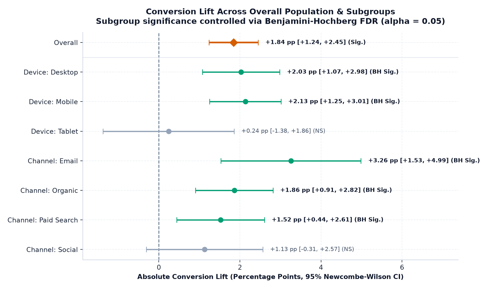
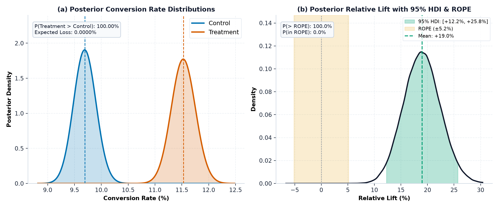

# A/B Test Analysis with Statistical Rigor

## Problem Statement
Did a checkout and landing-flow redesign improve user conversion rates and revenue per user, and how confident should product leadership be in shipping the change?

## Dataset
- **Source:** Deterministically simulated e-commerce experiment (`seed=42`, 14-day collection window) mirroring realistic multi-step checkout funnels, heterogeneous device/channel lift, and telemetry tracking anomalies.
- **Size:** `40,600` raw event rows -> `39,880` validated user records (`19,850` Control, `20,030` Treatment; `98.23%` retention rate) across `10` schema-enforced features (`user_id`, `timestamp`, `group`, `device`, `channel`, `viewed_landing`, `clicked_cta`, `started_checkout`, `converted`, `revenue`).
- **Data Quality Remediation:** Automated cleaning (`src/data_pipeline.py`) removes `239` duplicate user events, `241` mixed-group contamination records, `120` invalid/negative revenue entries, and `120` non-monotonic funnel records before statistical evaluation.

## Skills Demonstrated
Power analysis and sample size estimation, Sample Ratio Mismatch (SRM) gating, Frequentist hypothesis testing (two-proportion z-test, chi-square, Welch's t-test, Mann-Whitney U), Wilson & Newcombe-Wilson confidence intervals, Benjamini-Hochberg FDR multiple-testing correction, Bayesian Beta-Binomial inference (95% HDI, ROPE, expected loss, prior sensitivity), Pydantic v2 schema enforcement, and Babel i18n (`en` / `id`).

## Deliverables
- Dual-paradigm Frequentist and Bayesian evaluation of the same experiment (`src/frequentist.py`, `src/bayesian.py`)
- Pre-experiment sample size calculation, MDE power curves, and runtime estimation (`src/power.py`)
- Publication-quality visualizations (`reports/figures/`) and automated Markdown + PDF executive reports (`reports/executive_summary.md`, `reports/ab_test_report.pdf`)
- Interactive Streamlit dashboard (`app.py`) with English/Indonesian localization (`src/i18n.py`)
- Executed EDA and experiment analysis notebooks (`notebooks/01_eda.ipynb`, `notebooks/02_ab_analysis.ipynb`)

## Approach
1. **Data Cleaning & Schema Validation (`src/data_pipeline.py`, `src/schemas.py`)** - Enforce strict Pydantic v2 types (`UserEventRecord`, `extra="forbid"`, `allow_inf_nan=False`), strip mixed-group users, deduplicate earliest timestamps, and validate funnel monotonicity.
2. **Power & SRM Validity Gates (`src/power.py`, `src/frequentist.py`)** - Confirm minimum sample adequacy (`10,323` required per arm for 12% relative MDE at 80% power; `19,850` achieved -> `97.34%` power) and verify randomization balance via chi-square SRM test (`chi2 = 0.8124`, `p = 0.3674 >= 0.001`).
3. **Dual Statistical Inference (`src/frequentist.py`, `src/bayesian.py`)** - Evaluate conversion lift with Wilson/Newcombe CIs, two-proportion z-test, revenue metrics (Welch's t-test, Mann-Whitney U), BH-FDR adjusted segment tests, and conjugate Beta-Binomial posteriors with 95% HDI, ROPE (`+/-0.50 pp`), and 3-prior sensitivity checks.
4. **Reporting & Interactive Exploration (`src/visualizations.py`, `src/report.py`, `app.py`)** - Render charts, localize executive summaries, compile PDF deliverables, and serve an interactive dashboard.

## Key Results

| Metric | Control (`n=19,850`) | Treatment (`n=20,030`) | Lift / Statistical Evidence |
|---|---|---|---|
| **Conversion Rate** | `9.69%` (95% CI: `9.29% - 10.11%`) | `11.54%` (95% CI: `11.10% - 11.99%`) | `+1.84 pp` (`+19.03%` rel.), 95% CI `[1.24, 2.45] pp`, `z = 5.98`, `p = 2.24e-09`, Cohen's `h = 0.0599` |
| **Bayesian Posterior (`Beta(10, 90)`)** | Mean `9.69%` | Mean `11.53%` | `P(T > C) = 100.00%`, Rel. Lift 95% HDI `[12.20%, 25.78%]`, `P(> ROPE) = 100.00%`, Expected Loss `0.0000%` |
| **Revenue per User (RPU)** | `$5.99` | `$7.21` | `+$1.22` (`95% CI [$0.79, $1.65]`), Welch `p = 3.06e-08`, Mann-Whitney `p = 1.44e-09`, Cohen's `d = 0.0555` |
| **Average Order Value (AOV)** | `$61.78` | `$62.46` | `+$0.68` |
| **SRM & Power Gate** | `49.77%` traffic | `50.23%` traffic | SRM `p = 0.3674` (PASS); Achieved Power `97.34%` |

### Visual Evidence







## Key Findings
1. **Recommendation: `SHIP`** — The redesign increased conversion rate from `9.69%` to `11.54%` (`+1.84 pp`, `+19.03%` relative lift, `p = 2.24e-09`) with `100.00%` Bayesian posterior probability of beating control and `100.00%` probability of exceeding the `+/-0.50 pp` practical significance ROPE across all three prior specifications (`Beta(1,1)`, `Beta(10,90)`, `Beta(20,180)`).
2. **Heterogeneous Segment Lift (BH-FDR Adjusted):** Gains are strongest in **Email** (`+27.50%` rel., BH `p = 0.0004`) and **Mobile** (`+25.02%` rel., BH `p = 1.43e-05`), followed by **Organic** (`+19.34%`), **Desktop** (`+18.36%`), and **Paid Search** (`+16.16%`), whereas **Tablet** (`+2.75%`, BH `p = 0.7681`) and **Social** (`+13.77%`, BH `p = 0.1439`) show no statistically significant lift.
3. **Projected Business Impact:** Scaled to `3,000` daily visitors (`90,000` users / 30-day month), shipping the redesign projects **`1,660` incremental conversions/month** and **`$109,603` incremental monthly revenue** (`+$1.22` RPU).

## How to Run
```bash
# 1. Create virtual environment and install dependencies
python -m venv .venv
.venv\Scripts\activate
pip install -r requirements.txt -r requirements-dev.txt
pip install -r requirements-notebooks.txt  # optional, for Jupyter notebooks

# 2. Run the full statistical pipeline, figures, Markdown, and PDF report
python -m src.run_analysis --locale en --seed 42

# 3. Launch the interactive Streamlit dashboard
streamlit run app.py

# 4. Run tests and quality checks
pytest -v --cov=src --cov-report=term-missing
ruff check src app.py tests
mypy src --ignore-missing-imports
bandit -ll -r src app.py
```

### Docker
```bash
docker build -t ab-test-analysis .
docker run -p 8501:8501 ab-test-analysis
```

## Files
- `src/schemas.py` - Strict Pydantic v2 validation models (`ExperimentConfig`, `UserEventRecord`, `AnalysisReport`)
- `src/i18n.py` - Babel locale formatting and English/Indonesian translations (`en`, `id`)
- `src/data_pipeline.py` - Synthetic experiment generator and telemetry quality remediation
- `src/power.py` - Sample size estimation, Cohen's `h`, and multi-MDE power curves
- `src/frequentist.py` - SRM check, Wilson/Newcombe CIs, z-test, chi-square, Welch/Mann-Whitney RPU, funnel & BH-FDR segments
- `src/bayesian.py` - Conjugate Beta-Binomial model, 95% HDI, ROPE, expected loss, and prior sensitivity
- `src/visualizations.py` - Publication-quality PNG figures in `reports/figures/`
- `src/report.py` - SCQA Markdown executive summary and ReportLab PDF builder
- `src/run_analysis.py` - End-to-end reproducible CLI runner
- `app.py` - Interactive 4-tab Streamlit application
- `notebooks/01_eda.ipynb` - Executed exploratory & data quality audit notebook
- `notebooks/02_ab_analysis.ipynb` - Executed power, Frequentist, Bayesian, and segment analysis notebook
- `tests/` - Pytest unit and integration test suite
- `requirements.txt` - Pinned runtime dependencies for pipeline, PDF reporting, and Streamlit app
- `requirements-dev.txt` - Testing, linting, type-checking, and security audit tools
- `requirements-notebooks.txt` - Optional dependencies for executing Jupyter notebooks
- `GUARDRAILS.md` - Statistical, input validation, and security guardrail specifications

## Methodology & Limitations
This framework pairs fixed-horizon Frequentist testing with Bayesian Beta-Binomial estimation so business stakeholders see both long-run error control (`alpha = 0.05`, BH-FDR segment correction, SRM gate `alpha = 0.001`) and direct probability statements (`P(T > C)`, expected loss, and practical ROPE exceedance). Two-proportion Wilson and Newcombe-Wilson intervals avoid normal-approximation boundary distortion, while Welch's t-test and Mann-Whitney U accommodate right-skewed user revenue.

Key limitations apply: first, the dataset is deterministically generated to simulate realistic funnel drop-off and telemetry anomalies rather than sourced from live production logs. Second, fixed-horizon z-tests assume no unadjusted interim peeking; continuous monitoring would require group sequential alpha-spending or always-valid mSPRT p-values. Third, the 14-day window does not capture long-term novelty decay or repeat-purchase retention, which should be tracked over at least two full weekly post-launch cycles.

## Resume Bullet
> Designed an end-to-end Frequentist and Bayesian A/B experimentation engine in Python (`statsmodels`, `scipy`, `Pydantic v2`, `Streamlit`) with automated SRM gating, BH-FDR segment correction, and Beta-Binomial ROPE analysis across 39,880 validated users, identifying a +19.03% conversion lift (`p = 2.24e-09`, `P(T>C) = 100%`) projected at $109.6K incremental monthly revenue.
